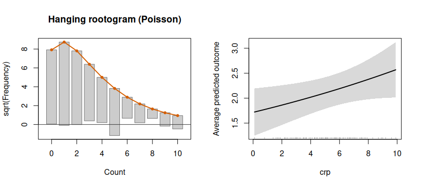

# panglm

panglm fits regression models for panel data (pooled, fixed effects,
random effects and the estimators built on them) for the outcomes and
designs of applied health econometrics, from one formula interface and
one set of post-estimation tools (robust and cluster covariances,
partial effects, specification tests, prediction, `tidy()`/`glance()`
output and base-graphics plots for every fitted object).

## Installation

``` r

# release from CRAN
install.packages("panglm")

# development version from GitHub
# install.packages("remotes")
remotes::install_github("ielbadisy/panglm")
```

## What it fits

| Task | Function |
|----|----|
| Continuous, binary, count, ordered, positive, bounded and censored outcomes (pooled, within, between, random effects) | [`panglm()`](https://elbadisyimad.com/panglm/reference/panglm.md) |
| Random slopes | `panglm(model = "random", random = ~ x)` |
| Costs with zeros (two-part model) | [`twopart()`](https://elbadisyimad.com/panglm/reference/twopart.md) |
| Counts with structural zeros | [`panhurdle()`](https://elbadisyimad.com/panglm/reference/panhurdle.md) |
| Difference-in-differences and event studies | [`did()`](https://elbadisyimad.com/panglm/reference/did.md), [`eventstudy()`](https://elbadisyimad.com/panglm/reference/eventstudy.md) |
| Staggered adoption | [`attgt()`](https://elbadisyimad.com/panglm/reference/attgt.md), [`etwfe()`](https://elbadisyimad.com/panglm/reference/etwfe.md) |
| Instrumental variables and Hausman-Taylor | [`paniv()`](https://elbadisyimad.com/panglm/reference/paniv.md) |
| Dynamic panels (difference and system GMM) | [`pangmm()`](https://elbadisyimad.com/panglm/reference/pangmm.md) |
| Sample selection | [`panselect()`](https://elbadisyimad.com/panglm/reference/panselect.md) |
| Quantile regression | [`panqr()`](https://elbadisyimad.com/panglm/reference/panqr.md) |
| Latent classes | [`panfmm()`](https://elbadisyimad.com/panglm/reference/panfmm.md), [`panfmmselect()`](https://elbadisyimad.com/panglm/reference/panfmmselect.md) |
| Specification tests | [`panhausman()`](https://elbadisyimad.com/panglm/reference/panhausman.md), [`pandispersiontest()`](https://elbadisyimad.com/panglm/reference/pandispersiontest.md), [`jointtest()`](https://elbadisyimad.com/panglm/reference/jointtest.md), [`lineartest()`](https://elbadisyimad.com/panglm/reference/lineartest.md) |
| Marginal effects and individual effects | [`partialeffects()`](https://elbadisyimad.com/panglm/reference/partialeffects.md), [`effectcurve()`](https://elbadisyimad.com/panglm/reference/effectcurve.md), [`fixef()`](https://elbadisyimad.com/panglm/reference/fixef.md), [`ranef()`](https://elbadisyimad.com/panglm/reference/fixef.md) |
| Plots | [`plot()`](https://rdrr.io/r/graphics/plot.default.html) methods, [`coefplot()`](https://elbadisyimad.com/panglm/reference/coefplot.md), [`eventplot()`](https://elbadisyimad.com/panglm/reference/eventplot.md), [`trendplot()`](https://elbadisyimad.com/panglm/reference/trendplot.md), [`treatmentplot()`](https://elbadisyimad.com/panglm/reference/treatmentplot.md), [`panelplot()`](https://elbadisyimad.com/panglm/reference/panelplot.md) |

Families:
[`gaussianfamily()`](https://elbadisyimad.com/panglm/reference/panglm-families.md),
[`binomialfamily()`](https://elbadisyimad.com/panglm/reference/panglm-families.md),
[`poissonfamily()`](https://elbadisyimad.com/panglm/reference/panglm-families.md),
[`negbinfamily()`](https://elbadisyimad.com/panglm/reference/panglm-families.md),
[`orderedfamily()`](https://elbadisyimad.com/panglm/reference/panglm-families.md),
[`gammafamily()`](https://elbadisyimad.com/panglm/reference/panglm-families.md),
[`betafamily()`](https://elbadisyimad.com/panglm/reference/panglm-families.md)
and
[`tobitfamily()`](https://elbadisyimad.com/panglm/reference/panglm-families.md).
Names with underscores
([`poisson_family()`](https://elbadisyimad.com/panglm/reference/panglm-deprecated.md),
[`panglm_hausman()`](https://elbadisyimad.com/panglm/reference/panglm-deprecated.md),
…) are deprecated; see
[`?"panglm-deprecated"`](https://elbadisyimad.com/panglm/reference/panglm-deprecated.md).

Numerical accuracy is documented in the [validation
article](https://elbadisyimad.com/panglm/articles/validation.html).

## Example

Exacerbation counts of 60 COPD patients over five visits, with a
random-effects Poisson model, cluster-robust standard errors, a Hausman
test against fixed effects and average partial effects:

``` r

library(panglm)
data(copd)

re <- panglm(exacerbations ~ crp + treatment + age, data = copd,
             index = c("id", "visit"), model = "random",
             family = "poisson", vcov = "cluster")
summary(re)
#> 
#> Call:
#> panglm(formula = exacerbations ~ crp + treatment + age, data = copd, 
#>     index = c("id", "visit"), model = "random", family = "poisson", 
#>     vcov = "cluster")
#> 
#> Family: poisson  Link: log  Model: random  Effect: individual 
#> n = 300  groups = 60  vcov: cluster 
#> 
#> Coefficients:
#>              Estimate Std. Error z value Pr(>|z|)    
#> (Intercept) -1.840104   0.525745  -3.500 0.000465 ***
#> crp          0.040731   0.020385   1.998 0.045711 *  
#> treatment   -0.309009   0.168576  -1.833 0.066795 .  
#> age          0.037769   0.007959   4.745 2.08e-06 ***
#> ---
#> Signif. codes:  0 '***' 0.001 '**' 0.01 '*' 0.05 '.' 0.1 ' ' 1
#> 
#> Log-likelihood: -517.8 
#> Dispersion parameter: 4.215 
#> Residual df: 295  Iterations: 4

fe <- panglm(exacerbations ~ crp, data = copd,
             index = c("id", "visit"), model = "within", family = "poisson")
panhausman(fe, re)
#> 
#>  Hausman specification test (fixed vs. random effects)
#> 
#> chisq = 3.211, df = 1, p-value = 0.07312
#> alternative hypothesis: one model is inconsistent

partialeffects(re)
#> 
#> Average partial effects
#> Delta-method standard errors, vcov: cluster 
#> 
#>       term contrast estimate std.error statistic   p.value  conf.low conf.high
#>        crp    dY/dX  0.08660   0.04280     2.023 0.0430500  0.002708   0.17050
#>  treatment    1 - 0 -0.63650   0.34350    -1.853 0.0638500 -1.310000   0.03667
#>        age    dY/dX  0.08031   0.01837     4.372 0.0000123  0.044310   0.11630
```

Every fitted object has a
[`plot()`](https://rdrr.io/r/graphics/plot.default.html) method. Here, a
hanging rootogram checks the count distribution, and
[`effectcurve()`](https://elbadisyimad.com/panglm/reference/effectcurve.md)
traces the average predicted count as CRP varies:

``` r

op <- par(mfrow = c(1, 2))
plot(re, which = "rootogram")
plot(effectcurve(re, "crp", scale = "response"))
```



``` r

par(op)
```

## Datasets

`copd` is a simulated panel with known parameters (counts, costs with
zeros, an ordered score, a proportion and a staggered care programme).
Five real health economics panels ship for teaching: `docvisits` (German
health care demand), `meps` (Medical Expenditure Panel Survey spending),
`medicaid` (US states, Medicaid expansion), `healthspend` (countries,
health expenditure) and `cigar` (US states, cigarette demand). Each help
page gives the source, the licence and the questions the data can teach.

## Learn more

- [Getting started with
  panglm](https://elbadisyimad.com/panglm/articles/panglm-intro.html)
- [Counts, costs, bounded and censored
  outcomes](https://elbadisyimad.com/panglm/articles/panglm-outcomes.html)
- [Endogeneity: IV, Hausman-Taylor, GMM and
  selection](https://elbadisyimad.com/panglm/articles/panglm-endogeneity.html)
- [Policy evaluation: DiD, event studies, attgt and
  etwfe](https://elbadisyimad.com/panglm/articles/panglm-policy.html)
- [Heterogeneity: random slopes, latent classes and quantile
  regression](https://elbadisyimad.com/panglm/articles/panglm-heterogeneity.html)
- [Teaching
  datasets](https://elbadisyimad.com/panglm/articles/panglm-datasets.html)
- [Technical
  reference](https://elbadisyimad.com/panglm/articles/panglm-methods.html)
- [Function reference](https://elbadisyimad.com/panglm/reference/)

panglm is the software of a forthcoming book on panel data methods for
health econometrics, whose examples it runs throughout.
